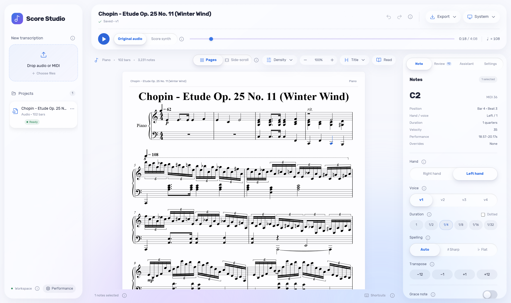
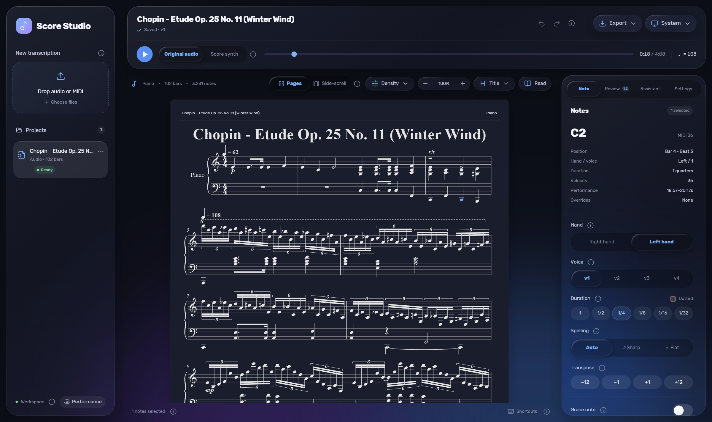

# Score Studio

Turn piano **audio** or **MIDI** into a readable, editable piano score in your browser.



<details><summary>Dark theme</summary>



</details>

```
audio ─► Transkun v2 (notes) ─┐
MIDI  ────────────────────────┴─► DuET (rhythm, bars, hands, key) ─► engraver (1–4 voices/staff) ─► MusicXML ─► editor
```

- **Transcribe** mp3/wav/flac/m4a/ogg or MIDI. Runs on CPU, or an NVIDIA GPU when available.
- **Edit** by clicking notes: hand, voice (1–4), duration, spelling, transpose, delete. Includes undo/redo and a review
  list of uncertain spots.
- **Play** the original audio or the score, with a following cursor. You can also use full-screen reading mode.
- **Export** MusicXML, MIDI or PDF (print).
- **Assistant** (optional): DeepSeek proposes structured edits for the bars you select. You preview them before
  applying.
- **MCP** endpoint so AI agents can transcribe, read, edit and export scores.

## Quick start (Docker)

```bash
git clone https://github.com/tommy-duan-github/score-studio.git
cd score-studio
docker compose up -d --build
```

Open <http://localhost:19287>. The first build downloads PyTorch (CPU), DuET and its weights, and Transkun, so it takes
a while. After that the container transcribes offline. See [docs/DOCKER.md](docs/DOCKER.md) for options: password,
CPU limits, MCP and environment variables.

## Run locally

**Requirements:** Python 3.11+ (3.12 recommended), Node.js 20.19+, Git, and [FFmpeg](https://ffmpeg.org/) on `PATH`
for audio input. Use an NVIDIA GPU with CUDA if you have one (optional).

```bash
git clone https://github.com/tommy-duan-github/score-studio.git
cd score-studio
python -m venv .venv
# Windows: .venv\Scripts\activate     Linux/macOS: source .venv/bin/activate

# 1. PyTorch: pick ONE
pip install torch torchaudio --index-url https://download.pytorch.org/whl/cpu      # CPU
pip install torch torchaudio --index-url https://download.pytorch.org/whl/cu128    # NVIDIA GPU

# 2. Models and backend
pip install "duet-score @ https://github.com/wei-zeng98/DuET/archive/6ac226b28206512eadd15be49579f04e00550759.tar.gz"
pip install --no-deps transkun==2.0.1
pip install -r backend/requirements.txt

# 3. Web UI
npm --prefix web ci
npm --prefix web run build

# 4. Start
python -m uvicorn app.main:app --app-dir backend --host 127.0.0.1 --port 8000
```

Open <http://127.0.0.1:8000>. On Windows, after setup, `start.bat` and `stop.bat` do steps 3–4 for you.

**Models are not stored in this repo.** The Transkun v2 checkpoint comes with its pip package. The DuET weights
(`Wayne42/DuET` on Hugging Face) download automatically the first time you transcribe, and are cached in
`~/.cache/huggingface`.

**Development:** run the backend with `--reload`, then run `npm --prefix web run dev` (http://localhost:5173, which proxies
`/api` to port 8000). `npm --prefix web run dev:mock` runs the UI with a built-in demo score and no backend.
`npm --prefix web run test:smoke` runs the Playwright tests (they need Chrome installed).

## Usage

1. Drop an audio or MIDI file on **New transcription**. MIDI takes about 1–3 minutes. Audio takes several minutes per
   minute of music on CPU, and is much faster on GPU.
2. Click a note to edit it in the **Note** panel. Shift-click or drag to select several notes. Click a bar number to
   select a measure. Keyboard shortcuts: `R`/`L` sets the hand, `1`–`4` sets the voice, arrows transpose, `Del` deletes,
   `Space` plays.
3. Work through the **Review** tab: it lists the engraver's uncertain spots (key, voices, meter).
4. **Settings** controls voices per staff (1–4), hand span, and automatic keys and spelling.
5. **Export** gives MusicXML or MIDI. Use print for PDF.

**Assistant:** open **Assistant → setup** and paste a [DeepSeek](https://platform.deepseek.com/) API key, or set
`DEEPSEEK_API_KEY`. The key is stored only in your local `data/config.json`, which is git-ignored.

Projects are saved in `data/projects/<id>/`. Delete a folder to remove that project. The HTTP API is documented in
[docs/API.md](docs/API.md), and the background research is in [RESEARCH.md](RESEARCH.md).

## Dependencies and licenses

Score Studio's own code is released under the [MIT License](LICENSE). Its dependencies are downloaded at install or
build time and keep their own licenses:

| Component | Used for | License |
|---|---|---|
| [DuET](https://github.com/wei-zeng98/DuET) code / engraver fork in `backend/app/engrave/` | MIDI → score | MIT |
| [DuET weights](https://huggingface.co/Wayne42/DuET) | MIDI → score model | **CC BY-NC 4.0 (non-commercial only)** |
| [Transkun v2](https://github.com/Yujia-Yan/Transkun) | audio → MIDI | MIT |
| [PyTorch](https://pytorch.org/) | model runtime | BSD-3-Clause |
| [FastAPI](https://fastapi.tiangolo.com/) / [Uvicorn](https://www.uvicorn.org/) | web server | MIT / BSD-3-Clause |
| [Verovio](https://www.verovio.org/) (Python + WASM) | engraving / rendering | LGPL-3.0-or-later |
| [React](https://react.dev/), [Tone.js](https://tonejs.github.io/), [@tonejs/midi](https://github.com/Tonejs/Midi) | UI, playback | MIT |
| [Lucide](https://lucide.dev/) | icons | ISC |
| [Rubik](https://github.com/googlefonts/rubik) font | UI font | SIL OFL 1.1 |
| [Salamander Grand Piano](https://tonejs.github.io/audio/salamander/) samples (fetched at runtime) | score playback | CC BY 3.0 |
| [FFmpeg](https://ffmpeg.org/) | audio decoding | LGPL/GPL (depending on build) |

Because the DuET weights are **non-commercial**, transcription with this tool is for personal and research use only.
See [THIRD_PARTY_NOTICES.md](THIRD_PARTY_NOTICES.md) for details.
